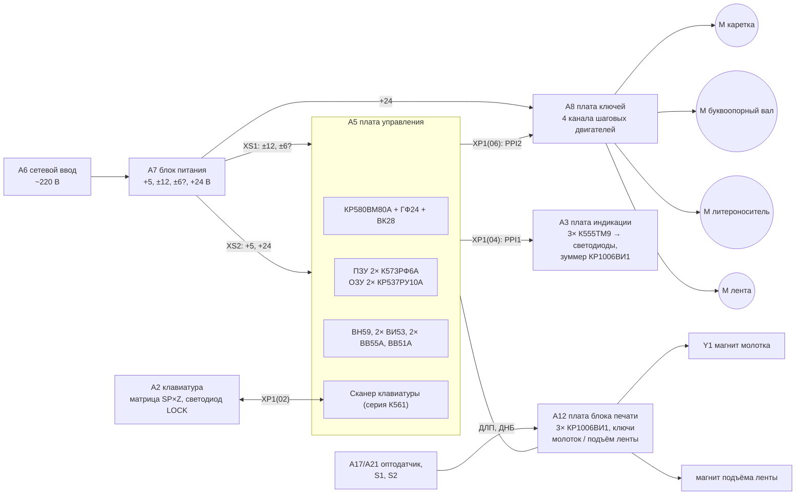

# «Элема» ПЭЛК 3110-01: расшифровка принципиальной схемы

Источник: «Схема электрическая принципиальная машины ПЭЛК 3110-01», 2 листа
(разраб. Савенкова, 21.06.91; зав. отделом Андрийчук). Сканы сняты фрагментами и склеены
скриптом `tools/stitch_scans.py`.

| Лист | Склеенный файл | Фрагменты | Содержимое |
|---|---|---|---|
| 1 | [`doc/elema/elema_sheet1.png`](../../doc/elema/elema_sheet1.png) | `doc/elema/scans/part1_*.jpg`, `part2_*.jpg` | Схема соединений блоков, перечень, плата индикации, блок питания, клавиатура |
| 2 | [`doc/elema/elema_sheet2.png`](../../doc/elema/elema_sheet2.png) | `doc/elema/scans/part3_*.jpg` | Плата управления (процессорная), плата ключей управления, плата блока печати, плата оптодатчика |

```sh
# Пересобрать листы из фрагментов
cd doc/elema
python3 ../../tools/stitch_scans.py -o elema_sheet1.png --ref 2 scans/part1_*.jpg scans/part2_*.jpg
python3 ../../tools/stitch_scans.py -o elema_sheet2.png --ref 2 --rotate 180 scans/part3_*.jpg
```

Разрешение сканов невысокое. Ниже записано только то, что удалось прочитать.
Сомнительные места помечены `?`. Таблицы разъёмов в машиночитаемом виде лежат в [`netlist/`](netlist/).

## Состав машины (лист 1, перечень)

| Поз. | Наименование | Обозначение |
|---|---|---|
| A1 | Кабель | ДАУ6.644.122 |
| A2 | Клавиатура | |
| A3 | Плата индикации | ДАУ6.120.383? |
| A4 | Кабель | 27.6936-038.2? |
| A5 | **Плата управления** (процессорная) | ДАУ6.120.33? |
| A6 | Блок сетевого ввода | |
| A7 | Блок питания | ДАУ5.087.023 |
| A8 | Плата ключей управления (драйверы двигателей) | |
| A9 | Двигатель шагового механизма | ДАУ5.118.012 |
| A10 | Двигатель буквоопорного вала | ДАУ5.118.005? |
| A11 | Кабель | ДАУ6.644.102 |
| A12 | Плата блока печати | ДАУ6.120.400 |
| A13 | Двигатель красящей ленты? (M1 — 4Н4035-04, импорт, «Япония») | ДАУ5.118.009 |
| A14 | Двигатель (M1 — 4Н40365-04, импорт, «Япония») | ДАУ5.118.008 |
| A15 | Магнит подъёма красящей ленты | ДАУ4.038.001 |
| A16 | Магнит молотка (Y1) | ДАУ4.035.002? |
| A17 | Оптодатчик: VD1 АЛ107А (ИК-светодиод), VD2 фотодиод ФД-265, R1 | ДАУ5.155.005 |
| A19 | Кабель | |
| A21 | Плата оптодатчика; S1, S2 — микропереключатели МП-9 | ДАУ6.120.331 |

Четыре шаговых двигателя, как у Robotron: каретка (шаговый механизм), буквоопорный вал
(подача бумаги), литероноситель и красящая лента. Плюс электромагниты молотка и подъёма ленты.

## Структурная схема



## A5 — плата управления

### Микросхемы

| Микросхема | Кол-во | Назначение |
|---|---|---|
| КР580ВМ80А | 1 | Процессор |
| КР580ГФ24 | 1 | Тактовый генератор, кварц ?,432 МГц (первая цифра не читается; для ГФ24 типично 18,432 МГц → 2,048 МГц) |
| КР580ВК28 | 1 | Системный контроллер: MEMR, MEMW, IOR, IOW, INTA |
| К555АП6 | ≥2 | Буферы шин адреса и данных |
| К573РФ6А | 2 | ПЗУ 8 КБ (`pelk_3101.1.bin`, `pelk_3110.2.bin`) |
| КР537РУ10А | 2 | Статическое КМОП ОЗУ 2 КБ → **4 КБ**. CS через ключ КТ315Б, блокируется сигналом RESET0 (сохранение данных при выключении) |
| КР1533ИД7 | 2 | Дешифраторы: выборка памяти (CSROM1/2, CSRAM1/2 через перемычки) и выборка периферии CS1…CS8 |
| КР580ВН59 | 1 | Контроллер прерываний |
| КР580ВИ53А | 2 | Таймеры |
| КР580ВВ55А | 2 | PPI1 — индикация и клавиатура, PPI2 — двигатели и электромагниты |
| КР580ВВ51А | 1 | Последовательный интерфейс (выводы на перемычки/разъём) |
| К561 (счётчики, К561КП2 и др.), КАС525В? | — | Аппаратный сканер клавиатуры |

### Дешифрация адресов (схема + прошивка)

```
Память, дешифратор ИД7 по старшим адресам (по прошивке A15..A13):
  0000h–1FFFh  CSROM1  К573РФ6А №1 (pelk_3101.1)
  2000h–3FFFh  CSROM2  К573РФ6А №2 (pelk_3110.2)
  6000h–6FFFh  CSRAM1/2  2× КР537РУ10А
  A000h        внешнее диагностическое ПЗУ (проверка 'R' в прошивке)

Порты, дешифратор ИД7 по A4..A2 при A7..A5 = 111:
  E0h CS1  ВИ53 №1        F0h CS5  ВВ55 №2 (PPI2)
  E4h CS2  ВИ53 №2        F4h CS6  ВВ51
  E8h CS3  клавиатура     F8h CS7  датчики
  ECh CS4  ВВ55 №1 (PPI1) FCh CS8  ВН59
```

Какие именно разряды адреса заведены на дешифраторы, на скане не читается.
Разбиение выше выведено из прошивки и согласуется с количеством выходов дешифраторов.

### Прерывания (ВН59, входы IR)

| IR | Источник по схеме | Роль в прошивке | Маска |
|---|---|---|---|
| IR1 | ВИ53 №1 OUT0 | Двигатель 1 | открыт |
| IR2 | ВИ53 №1 OUT1 | Двигатель 2 | открыт |
| IR3 | ВИ53 №2 OUT2 (`IR3`/`IR5` на скане неразличимы) | Двигатели 3/4, такт главного цикла | открыт |
| IR4 | сканер клавиатуры? | Клавиатура, `in E8h` | открыт |
| IR5 | ВВ51 TxRDY | — | **закрыт** |
| IR6 | ВВ51 RxRDY | — | **закрыт** |
| IR7 | ВИ53 №2 OUT0 | Длительность звукового сигнала | открыт |

ВИ53 №2 OUT1 заведён на **CLK** — это тактирование ВВ51 (TxC/RxC). Прошивка канал 1 этого
таймера (`E5h`) не программирует, а ВВ51 после инициализации получает команду `00h`
(приёмник и передатчик выключены). Последовательный порт разведён на плате, но заводской
прошивкой **не используется**. Похоже на историю с RS-232 у Robotron, только здесь кода
работы с портом, видимо, нет совсем.

### PPI1 (ECh–EFh): индикация и клавиатура → XP1(04), XP1(02)

| Порт | Бит | Цепь | Назначение |
|---|---|---|---|
| PA (`ECh`) | 0–7 | AD0–AD7 | Данные на защёлки платы индикации |
| PB (`EDh`) | 0–2 | AA0–AA2 | Стробы защёлок D1–D3 К555ТМ9 |
| PB | 3, 4 | AA3, ADSA | На плате индикации не используются |
| PB | 5, 6 | **AAG1, AAG2** | **Зуммер** (КР1006ВИ1 на плате индикации) |
| PB | 7 | LOCK | Светодиод на клавиатуре (через инвертор) |
| PC | 1 | ASTB | |
| PC | 0, 2, 3, 5–7 | PC0…PC7 | Выведены на разъём XP1(04) |

Здесь поправка к прежней гипотезе: биты 5–6 порта `EDh` управляют **звуком**, а не молотком.
Процедура `0F09h` задаёт длительность через ВИ53 №2 канал 0 (`E4h`), а обработчик IRQ7
`0F1Bh` выключает звук.

### PPI2 (F0h–F3h): двигатели и электромагниты → XP1(06)

| Порт | Бит | Цепь | Назначение |
|---|---|---|---|
| PA (`F0h`) | 0–7 | Ф1–Ф4 ×2 | Фазы двигателей 1 и 2 |
| PB (`F1h`) | 0–7 | Ф1–Ф4 ×2 | Фазы двигателей 3 и 4 |
| PC (`F2h`) | 0, 1 | FW0, FW1 | Режим (ток удержания) двигателя W |
| PC | 2, 3 | FP0, FP1 | Режим двигателя P |
| PC | 4, 5 | FT0, FT1 | Режим двигателя T |
| PC | 6 | DHM | Молоток (Druckhammer?) |
| PC | 7 | FB MAG | Магнит красящей ленты (Farbband?) |

Маски в прошивке (`ani FCh`, `ani F3h`, `ani CFh`, `ani 7Fh`, `ori 40h`) точно совпадают с этой
раскладкой. Имена DHM и FB взяты, по-видимому, из документации Robotron
(в S6130: DHM — молоток, FBS — лента).

### Разъёмы

- `XP1(02)` → клавиатура: `~SP10…~SP17`, `~SP20…~SP24`, `~Z0…~Z7`, `~LOCK`, +5 В, общий
  ([CSV](netlist/control_XP1-02_keyboard.csv)).
- `XP1(03)`: +5 В, `DBE`, общий.
- `XP1(04)` → плата индикации ([CSV](netlist/control_XP1-04_indicator.csv)).
- `XP1(06)` → плата ключей управления ([CSV](netlist/control_XP1-06_keys.csv)).
- `XP1(07.1)`, `XP1(07.2)`: входы A1, A2 → D1, D2 (датчики).

## A3 — плата индикации

Буквенно-цифрового дисплея **нет**, только светодиоды. Схема:

- **D1–D3 К555ТМ9** — шесть D-триггеров в каждой. Входы D1–D6 ← AD0–AD5, тактовые входы C
  ← AA0, AA1, AA2. Выходы Q1–Q6 → светодиоды АЛ307ГМ (VD1…VD20) через резисторные сборки
  RA2, RA3 НР1-4-9 330 Ом. Итого до 18 индикаторов режимов.
- **RA1** НР1-4-9 22 кОм — подтяжка шины AD.
- **D4 КР1006ВИ1** (аналог 555) — генератор зуммера. Запуск от AAG1/AAG2 через VD1, VD2
  КД522Б. Выход через R4 2,2 кОм на VT1 КТ972А, нагрузка ЗП-3 (R7 150 Ом).
- C1 К10-7В-Н90-0,068 мкФ; C2, C3 К10-7В-Н90-0,015 мкФ; C4 К50-35-25В-22 мкФ.
- Разъём XS1 ОНП-КГ-56-30/42,9-6,5-Р50, вилка XT1 ОНп-КГ-56-30/43,5×10,2
  ([CSV](netlist/indicator_XS1.csv)).

## A2 — клавиатура

Матрица из 13 линий `~SP10…~SP17`, `~SP20…~SP24` и 8 линий `~Z0…~Z7`, светодиод VD1 АЛ307ГМ (`LOCK`).
Разъёмы XS1 ОНП-КГ-56-30/42,9-6,5-Р50, XT1 ОНп-КГ-56-30/43,5×10,2
([CSV](netlist/keyboard_XT1.csv)). Раскладка ЙЦУКЕН, нарисована на листе 1.

## A7 — блок питания

Трансформатор T1, стабилизаторы на плате. Разъёмы СНО46-6РП ([CSV](netlist/psu.csv)):

| XS1 | | XS2 | |
|---|---|---|---|
| 6 | −6 В? | 1 | +5 В |
| 4 | −12 В | 2 | общий |
| 5 | +12 В | 4 | общий |
| 1 | +6 В? | 3 | +24 В |
| 2, 3 | общий | 5 | +24 В |

На скане цифры 5 и 6 неразличимы. КР580ВМ80А нужно −5 В, так что «−6 В» почти наверняка −5 В.
Проверить мультиметром до установки процессора.

## A8 — плата ключей управления

Четыре одинаковых канала драйвера шагового двигателя: силовые транзисторы (КТ8xx, на
транзисторах VT1–VT9, VT11, VT17, VT18, VT23 нужны радиаторы) и диоды КД521/КД522. Логика —
микросхемы D1…D3 (питание +5 В на вывод 14, общий на вывод 7).

Сокращения, принятые в схеме (дословно с листа):

| Сокращение | Расшифровка |
|---|---|
| ФС | фаза силовая шагового двигателя |
| RESET | сброс |
| ФОР.БОВ | статический режим работы шагового двигателя буквоопорного вала |
| ФОО.БП | статический режим работы шагового двигателя блока печати |
| ЭНП | сигнал управления подъёмом красящей ленты |
| ДНБ | сигнал наличия бумаги |
| ДЛП | сигнал исходного положения литероносителя |
| ЭМН | сигнал управления электромагнитом молотка |

Вероятно, сигналы «статического режима» и есть FW/FP/FT из PPI2: они переключают ток
удержания обмоток.

## A12 — плата блока печати

Три КР1006ВИ1 (формирователи импульсов), ключи на КТ829?/КТ815?, разъёмы XP1…XP9.
Сигналы: ЭМН (молоток), ЭНП (подъём ленты), ДЛП (исходное положение литероносителя),
ДНБ (наличие бумаги), питание 24 В / 5 В. Отсюда идут датчики, которые прошивка читает через порт `F8h`
(предположение).

## A21 — плата оптодатчика

ИК-светодиод АЛ107А и фотодиод ФД-265 с компаратором. Скорее всего, это датчик исходного
положения литероносителя (ДЛП).

## Что не удалось прочитать

- Номера выводов ВВ55, ВИ53 и ВН59 (входы IR подписаны, но мелко).
- Разряды адреса на входах обоих КР1533ИД7.
- Номинал кварца ГФ24.
- Номиналы и типы большинства элементов на плате ключей и плате блока печати.
- Позиционные обозначения клавиш.

Для полной перерисовки (например, в KiCad) нужны сканы 300–600 dpi или фото плат.
