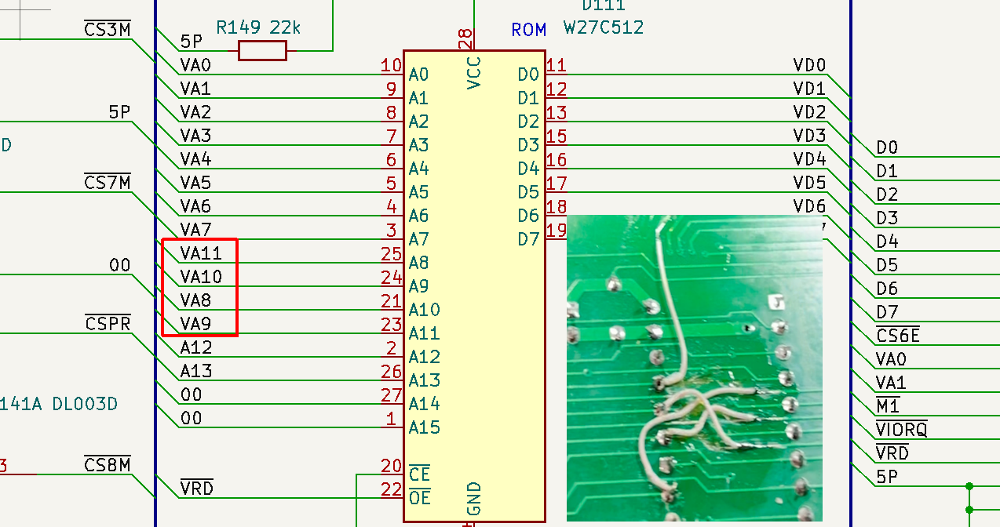
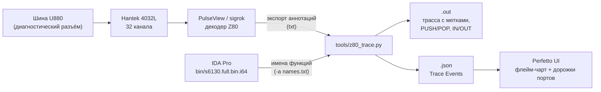

# Robotron S6130: журнал оживления

Краткая выжимка из статьи [«Robotron S6130 — Восставший из мертвых»](https://habr.com/ru/companies/yadro/articles/886254/)
плюс то, что потом нашлось в коде.

## Хронология

| Когда | Что сделано |
|---|---|
| ~2017 | Машинка попадает к автору. До этого ~4 года пролежала в сыром помещении: батарейка ОЗУ протекла и съела дорожки, ноги микросхем ОЗУ покрылись коррозией. Признаков жизни нет |
| 2019 | Проверена плата драйверов шаговых двигателей. ПЗУ выпаяны и прочитаны (`bin/s6130.*.bin`), ОЗУ проверены: **8 из 16 мёртвые**. В дампе найден код RS-232. Куплена «Элема» |
| 2019–2021 | Найдены схема, руководство и сервисные описания родственных моделей. Решение: делать новую материнскую плату |
| янв. 2022 | Подписчик Folk разводит плату в KiCad (`sch/s6130_kicad/`): габариты и расположение деталей как у оригинала, одна ПЗУ и одна ОЗУ вместо 23 корпусов, распаян RS-232 |
| март 2023 | Плата 130 × 450 мм изготовлена PCBWay |
| янв. 2025 | Сборка и запуск, отладка логическим анализатором, разбор прошивки. **Машинка ожила**, RS-232 заработал |

## Сборка новой платы: на что наступили

1. **Доступность компонентов.** Часть номенклатуры 1986 года уже не найти. Диоды заменены
   современными в других корпусах. Rail-to-rail ОУ в DIP-6 нашёлся только один (снят со старой
   платы), второй впаян в SMD-корпусе «враскорячку».
2. **ChipSelect на диодах.** Объединение 16 CS ОЗУ (и 7 CS ПЗУ) «пачкой диодов» на 2,5 МГц
   давало плохие фронты. Диоды пришлось выкусить и переделать навесным монтажом.
   Сейчас ПЗУ занимает всё окно `0000h–3FFFh`, так что диагностическое ПЗУ на `3800h` временно
   не работает.
3. **Адресные линии ПЗУ не по порядку.** В оригинале адреса к ОЗУ разведены вразнобой (так проще
   трассировать), и при копировании это ушло и на ПЗУ. Исправлено перерезанием дорожек и перемычками.
   Потом пришлось исправлять уже сам хардфикс: два провода перепутали местами
   (процессор пролетал мимо `CALL 1EE0h`).

   

4. **Ошибки в изменённых узлах.** Пара перерезанных дорожек и 10 минут паяльником.

## Отладка

### Шаг 1. Есть ли жизнь

Питание, CLK, сброс и отсутствие HALT в порядке. 16-канальный анализатор на шине данных показывает
первые выборки: `31 40 40` (`ld sp, 4040h`), `FF` (`rst 38h`): код исполняется.

### Шаг 2. Полная трасса

16 каналов мало: нужны 8 линий данных, 16 адресных и управляющие. Куплен 32-канальный
**Hantek 4032L**, изготовлен переходник «диагностический разъём → IDC-40» с распиновкой анализатора.

### Шаг 3. Машинка висит в `Setup_all`

В трассе видно, что `Setup_all` бесконечно опрашивает функциональную клавиатуру. Опрашивается код
`99h` = `{10, 011, 001}`: функциональная матрица, строка 2, столбец 4. Это **концевик крышки**.
С открытой крышкой прошивка ждёт её закрытия. Если замкнуть концевик до включения, каретка
уходит на парковку.

### Шаг 4. Мёртвые CTC

Системный таймер получал настройки, но не генерировал прерываний. После перестановки CTC
прерывания появились, но мёртвый чип (родной, с оригинальной платы) оказался на месте CTC cs6
последовательного порта: настройки принимает, на выходе TO тишина. Заменён на чип с донора.

### Результат

Машинка перемещает каретку влево до упора, ставит литерный диск в ноль по датчику, возвращает
каретку на отступ и ждёт клавиатуру. Ещё понадобились чистка соленоида и новые «пятаки»
на плёночной клавиатуре.

## Патчи прошивки

`bin/s6130.full.bin` — оригинал, `bin/s6130.full_new.bin` — патченная версия
(24 КБ, хвост `3800h–5FFFh` заполнен `FFh`). Отличия (проверено побайтовым сравнением):

| Адрес | Было | Стало | Зачем |
|---|---|---|---|
| `00ECh` | `00h` | `8Ch` | Код клавиши «Приём по интерфейсу» в таблице меню MOD |
| `00EFh` | `00h` | `9Dh` | Код клавиши «Передача по интерфейсу» |
| `00F9h` | `0Fh` | `BBh` | Пиктограмма «приём» в меню MOD |
| `00FAh` | `0Fh` | `BAh` | Пиктограмма «передача» |
| `00FBh` | `0Fh` | `94h` | Пиктограмма «смена языка» (клавиша не найдена, код остался `00h`) |
| `37EDh` | `00h` | `44h` | SIO WR4: асинхронный режим, 1 стоп-бит, ×16 |

### Почему без патча `37EDh` SIO оказывался в синхронном режиме

Байт `37EDh` — шаблон регистра WR4. `UsartCtrl` добавляет к нему младшую тетраду слова
DIP-переключателей (стоп-биты и чётность) и биты делителя. На заводских платах DIP-переключатели
не ставили, все биты читаются нулями, и в поле стоп-битов WR4 остаётся `00` — синхронный режим.
Патч зашивает 1 стоп-бит прямо в шаблон. Подробно — в [hardware.md](hardware.md#rs-232).

Альтернатива патчу: распаять DIP-переключатели по `doc/serielles_interface_robotron_esm.pdf`.
Тогда скорость тоже можно будет выбирать (110…9600 бод).

## Подключение к ПК

- Полноценный нуль-модемный кабель (с линиями управления потоком).
- Настройки (DIP не установлены, патченная прошивка): **110 бод, 7 бит, без чётности, 1 стоп-бит**.
- В меню MOD появились пункты «Приём» и «Передача». Работает **либо** приём, **либо** передача:
  одновременный режим терминала включить не удалось.

### Кодировка

Таблица символов похожа на КОИ-7 Н1, но заполнена с ошибками:

- строчные **э, ш, щ** на клавиатуре есть, но при передаче уходят как `07h`, `02h`, `0Ah`,
  а при приёме этих кодов происходит совсем другое;
- если отправить в машинку все коды `00h–FFh`, **э, ш, щ** так и не печатаются.

Исправлять придётся таблицу `Code_page` (`0115h`). Есть escape-последовательности, например
`1Bh 52h` включает подчёркивание. Возможно, недостающие буквы доступны через них.

## Известные проблемы

- Сильно греется снаббер в блоке питания.
- Странно перегреваются некоторые элементы драйвера моторов.
- Пока это не исправлено, машинку не стоит надолго оставлять включённой без присмотра.

## Инструментарий



Формат файла имён для `-a`: строки, где встречается `ROM`, разбиваются по пробелам;
1-е поле — имя, 3-е — адрес в hex (как в выгрузке сегментов/имён IDA, например
`Setup_all ROM 1EE0`).

Пример трассы:

```
1057881:    0000 31 40 40          LD SP,4040h
1057891:    0003 FF                RST 38h        PUSH 0004 -> 0x403F
Call Check_debug@0038 | Unknown -> Stack
1057917:    003A 3A 00 38          LD A,(3800h)   op: 0x3800(FF)
...
1057995:    19EF CD E0 1E          CALL 1EE0h     PUSH 19F2 -> 0x403F
Call Setup_all@1EE0 | Unknown -> Stack
```

Как это использовать:

- Где застряла прошивка: в Perfetto видно, какая функция крутится и какие порты она опрашивает.
- Откуда данные: по `op: 0xADDR(VAL)` в трассе можно найти, кто записал значение в ОЗУ, а затем
  из какой таблицы ПЗУ оно скопировано (так нашлись таблицы меню MOD `00E0h`/`00F5h`).
- Какой мотор работает: вектор `404Ah`/`404Ch` показывает текущий обработчик.

Что можно улучшить: подключить `sigrok-cli` и встроенный декодер напрямую, чтобы получать
трассу и JSON без ручного экспорта из PulseView.

Программатор для ПЗУ: TL866 Plus II.
