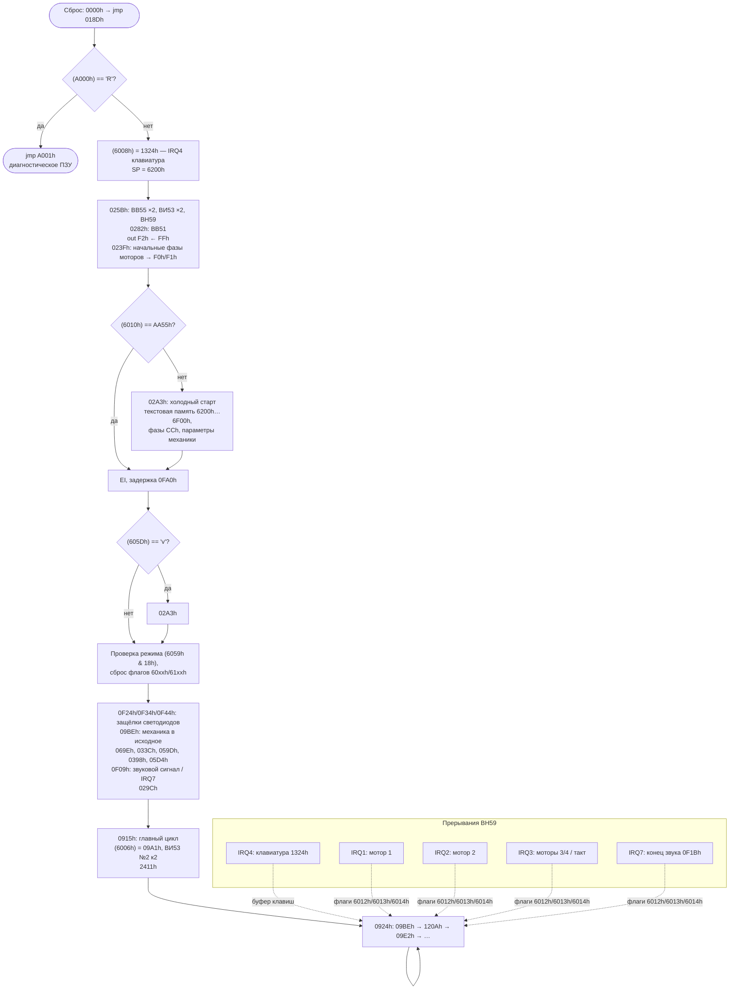

# «Элема» (ПЭЛК-3110): прошивка

Разбор прошивки КР580ВМ80А. Аппаратная часть описана в [../hw/README.md](../hw/README.md).
Отметки: ✅ — подтверждено схемой, ❔ — только по коду.

## Прошивка

| Файл | Адреса | Описание |
|---|---|---|
| `pelk_3101.1.bin` | `0000h–1FFFh` | ПЗУ №1, 8 КБ |
| `pelk_3110.2.bin` | `2000h–3FFFh` | ПЗУ №2, 8 КБ |
| `pelk_3101.full.bin` | `0000h–3FFFh` | Склейка (проверено: `cat 1 2` = `full`) |
| `pelk_3101.full.bin.asm` | — | Листинг i8080 без разметки |

Код занимает `0000h–~3604h`, остальное — `FFh`.

## Родство с прошивкой Robotron

Код написан заново под 8080, но архитектура узнаваема. Видимо, разработчики «Элемы»
переносили прошивку S6130:

| Что | Robotron S6130 (Z80) | «Элема» (8080) |
|---|---|---|
| Вход в диагностическое ПЗУ | `ld a,(3800h)` / `cp 'R'` / `jp 3803h` | `lda A000h` / `cpi 'R'` / `jz A001h` |
| Сигнатура целостности ОЗУ | `55AAh` в `4222h` | `AA55h` в `6010h` (проверка `+55ABh = 0`) |
| Прерывания | IM 2, таблица в ОЗУ `4040h+` | ВН59, заглушки в ПЗУ `27C0h+` → адреса в ОЗУ `6000h+` |
| Обработчики моторов | Адрес в векторе подменяется на лету | То же: в `6002h`/`6004h`/`6006h` пишутся разные адреса |
| Шаговые двигатели | Фазы `66 CC 99 33`, программная коммутация | Начальная фаза `CCh` в `F0h`/`F1h`, программная коммутация |
| Таймеры моторов | CTC Ch0–Ch2 | ВИ53, режим 0 (прерывание по окончании счёта) |
| Таймер повтора/задержек | — | Цикл `0829h` (`dcx h` до нуля) |

Поэтому [документация на S6130](../../s6130/fw/README.md) — хорошая подсказка при разборе.

## Карта памяти

ПЗУ — 2× К573РФ6А (8 КБ), ОЗУ — 2× КР537РУ10А (2 КБ, КМОП, с защитой от записи при
выключении), выборка через КР1533ИД7 ✅. Точные границы зон выведены из прошивки.

```
0000h ┌──────────────────────────┐
      │ ПЗУ №1 8 КБ (pelk_3101.1)│  0000h: jmp 018Dh
      │                          │  0003h–018Ch: таблицы
2000h ├──────────────────────────┤
      │ ПЗУ №2 8 КБ (pelk_3110.2)│  27C0h–27FFh: заглушки прерываний
4000h ├──────────────────────────┤
      │ (не используется)        │
6000h ├──────────────────────────┤
      │ ОЗУ 4 КБ                 │  6000h–600Fh: адреса обработчиков IRQ0–7
      │                          │  6010h: сигнатура AA55h
      │                          │  ~6100h–61FFh: стек (SP = 6200h)
      │                          │  6200h–6EFFh: текстовая память (предп.)
~6FFFh└──────────────────────────┘
A000h   Диагностическое ПЗУ: (A000h) = 'R' → jmp A001h
```

Обращения к адресам выше `6FFFh` в листинге — данные, ошибочно дизассемблированные как код.

## Карта портов

```asm
025B  mvi a,80h / out EFh / out F3h      ; два ВВ55: режим 0, все порты — выходы
0261  mvi a,30h / out E3h                ; ВИ53 №1: канал 0, LSB+MSB, режим 0
0265  mvi a,70h / out E3h                ; ВИ53 №1: канал 1, LSB+MSB, режим 0
0269  mvi a,20h / out E7h                ; ВИ53 №2: канал 0, только MSB, режим 0
026D  mvi a,B0h / out E7h                ; ВИ53 №2: канал 2, LSB+MSB, режим 0
0271  mvi a,FFh / out E7h                ;   (?)
0275  mvi a,D2h / out FCh                ; ВН59 ICW1: интервал 8, одиночный, A7..A5 = 110
0279  mvi a,27h / out FDh                ; ВН59 ICW2: старший байт = 27h → векторы 27C0h + 8·n
027D  mvi a,61h / out FDh                ; ВН59 OCW1: замаскированы IRQ0, IRQ5, IRQ6
0282  xra a / out F5h ×3, 40h, DEh, 00h  ; ВВ51: сброс, режим DEh, команда 00h
```

| Порт | Микросхема | Назначение | |
|---|---|---|---|
| `E0h` | ВИ53 №1, канал 0 | Таймер двигателя 1 → IR1 | ✅ |
| `E1h` | ВИ53 №1, канал 1 | Таймер двигателя 2 → IR2 | ✅ |
| `E2h` | ВИ53 №1, канал 2 | Не используется прошивкой | ❔ |
| `E3h` | ВИ53 №1, управление | | ✅ |
| `E4h` | ВИ53 №2, канал 0 | Длительность **звукового сигнала** → IR7 | ✅ |
| `E5h` | ВИ53 №2, канал 1 | OUT1 → CLK ВВ51 (скорость RS-232). Прошивка не программирует | ✅ |
| `E6h` | ВИ53 №2, канал 2 | Таймер двигателей 3/4 → IR3 | ✅ |
| `E7h` | ВИ53 №2, управление | | ✅ |
| `E8h` | вход | Код клавиши от аппаратного сканера клавиатуры → IR4 | ❔ |
| `ECh` | ВВ55 №1 (PPI1), порт A | AD0–AD7: данные защёлок светодиодов на плате индикации | ✅ |
| `EDh` | PPI1, порт B | b0–b2 AA0–AA2: стробы защёлок К555ТМ9; **b5–b6 AAG1/AAG2: зуммер**; b7 LOCK | ✅ |
| `EEh` | PPI1, порт C | PC0–PC7 на разъём индикации (PC1 = ASTB) | ✅ |
| `EFh` | PPI1, управление | `80h` | ✅ |
| `F0h` | ВВ55 №2 (PPI2), порт A | Фазы двигателей 1 (b7–4) и 2 (b3–0) | ✅ |
| `F1h` | PPI2, порт B | Фазы двигателей 3 и 4 | ✅ |
| `F2h` | PPI2, порт C | b0–1 FW0/1, b2–3 FP0/1, b4–5 FT0/1 — режимы двигателей; b6 DHM (молоток); b7 FB MAG (лента) | ✅ |
| `F3h` | PPI2, управление | `80h` | ✅ |
| `F4h` | ВВ51 (КР580ВВ51А), данные | Последовательный порт → XS109 (RS-232) | ✅ |
| `F5h` | ВВ51, управление | Режим `DEh`: асинхронный, ×16, 8 бит, нечётный паритет, 2 стоп-бита; команда `00h` (приём и передача выключены) | ✅ |
| `F8h` | вход | Датчики (b2, b6 и др.) | ❔ |
| `FCh` | ВН59 (КР580ВН59), A0 = 0 | ICW1, EOI (`20h`) | ✅ |
| `FDh` | ВН59, A0 = 1 | ICW2, маска | ✅ |

Подробно о сигналах на разъёмах — в [описание схемы](../hw/README.md).

Обращения `in 1Dh` в листинге (`1D28h`…) — данные, а не код.

## Прерывания

ВН59 при подтверждении прерывания выдаёт на шину `CALL 27C0h + 8·n`. По каждому из 8 адресов лежит
одинаковая заглушка, которая сохраняет регистры и прыгает по адресу из ОЗУ:

```asm
27C0  push h / push psw / push b / push d
      lhld 6000h        ; 6000h + 2·n — адрес обработчика IRQn
      pchl
```

Общий выход из обработчика (`04CDh`):

```asm
04CD  pop d / pop b
      mvi a,20h / out FCh   ; EOI в ВН59
      pop psw / pop h
      ei / ret
```

| IRQ | Ячейка | Маска | Кто записывает | Источник |
|---|---|---|---|---|
| 0 | `6000h` | закрыт | — | — |
| 1 | `6002h` | открыт | `0450h`, `062Ch`, `0775h`, `07A9h` | ✅ ВИ53 №1 OUT0 — двигатель 1 (`04CAh` → `0464h`) |
| 2 | `6004h` | открыт | `0503h`, `06D8h` | ✅ ВИ53 №1 OUT1 — двигатель 2 (`0596h` → `0517h`) |
| 3 | `6006h` | открыт | `0744h`, `0918h`, `097Dh`, `09D1h` | ✅ ВИ53 №2 OUT2 — двигатели 3/4, такт главного цикла (`09A1h`) |
| 4 | `6008h` | открыт | `019Ch` (= `1324h`), `2EC0h`, `2EE5h` | ❔ Сканер клавиатуры: `in E8h`, код `68h` — особая клавиша |
| 5 | `600Ah` | закрыт | — | ✅ ВВ51 TxRDY |
| 6 | `600Ch` | закрыт | — | ✅ ВВ51 RxRDY |
| 7 | `600Eh` | открыт | `0F0Ch` (= `0F1Bh`) | ✅ ВИ53 №2 OUT0 — конец звукового сигнала (сброс AAG1/AAG2, биты 5–6 порта `EDh`) |

## Структура прошивки



### Области ПЗУ *(первичная разметка)*

| Диапазон | Содержимое |
|---|---|
| `0000h–0002h` | `jmp 018Dh` |
| `0003h–018Ch` | Таблицы (в т.ч. строка раскладки `a#3+5_.:*U@8MVHO^W,S2YL$FZ&?A[KNP\<JQ]6B4XI0DT(R'>`G7C%E1cu` по `00BAh`) |
| `0038h` | `jmp 0000h`: выполнение `FFh` из пустого ПЗУ = перезапуск |
| `018Dh–023Eh` | Старт и инициализация |
| `023Fh–02A2h` | Инициализация периферии |
| `02A3h–033Bh` | Холодный старт |
| `0398h–0828h` | Моторы: обработчики IRQ1–3, разгон/торможение |
| `0829h` | Задержка (HL итераций) |
| `0915h–09FFh` | Главный цикл |
| `0F09h–0F53h` | Молоток (IRQ7), защёлки `ECh`/`EDh` |
| `1324h` | Обработчик клавиатуры (IRQ4) |
| `2BFFh` | Таблица ASCII ` !"#$%&'()*+,-./0123…` |
| `27C0h–27FFh` | Заглушки прерываний ВН59 |
| `~3604h–3FFFh` | Пусто (`FFh`) |
