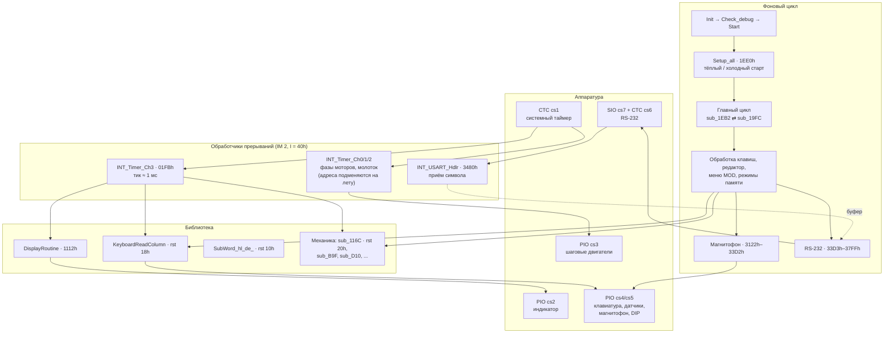
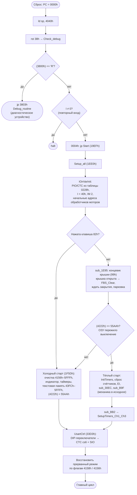
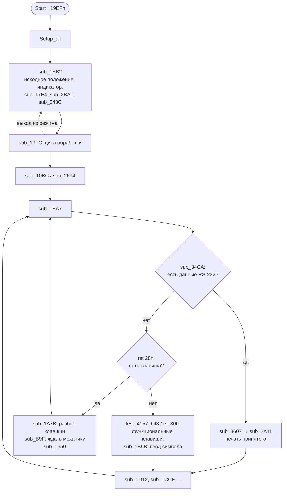
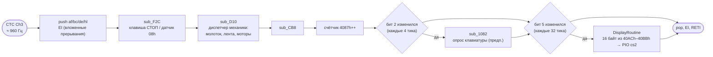
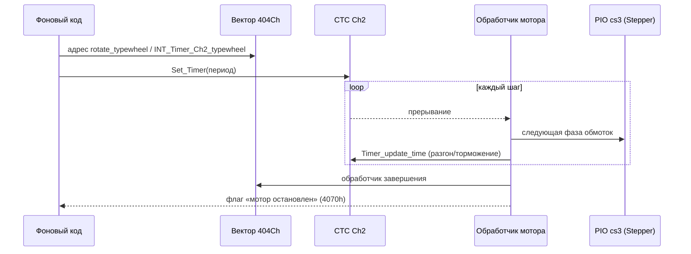
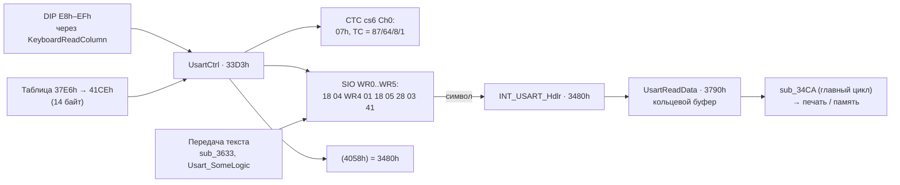

# Robotron S6130: структура прошивки

Прошивка: `s6130.full.bin` (14 КБ, Z80/U880), листинг IDA: `s6130.full.bin.asm`.
Имена функций взяты из разметки в IDA. Имена с пометкой *(предп.)* — предположения по
коду, на железе они не проверены. Безымянные `sub_XXXX` пока не разобраны.

## Обзор

## Карта ПЗУ

| Диапазон | Корпус | Содержимое |
|---|---|---|
| `0000h–0037h` | ROM1 | RST-векторы: `Init`, `rst 10h` → `SubWord_hl_de_`, `rst 18h` → `KeyboardReadColumn`, `rst 20h` → `sub_116C`, `rst 28h` → `sub_1094`, `rst 30h` → `sub_F73` |
| `0038h–004Bh` | ROM1 | `Check_debug` (`rst 38h`): переход в диагностическое ПЗУ |
| `004Ch–0056h` | ROM1 | `CleanupMemory`: очистка `4041h–40FFh` |
| `0066h` | ROM1 | NMI → `jp 5FFDh` |
| `0057h–010Fh` | ROM1 | Константы: фазы шаговых двигателей (`0091h`), тайминги, **меню MOD** (`00E0h`, `00F5h`) |
| `0115h–01FAh` | ROM1 | `Code_page`: таблица перекодировки символов (близка к КОИ-7 Н1) |
| `01FBh–0293h` | ROM1 | Системный тик, таблицы инициализации CTC/PIO, `IOnVarInit`, `IO_WriteFromTable` |
| `0294h–0696h` | ROM1 | Таблицы (раскладка клавиатуры, параметры механики) |
| `0697h–0BEAh` | ROM1–2 | **Драйверы механики**: `Set_Timer`, `rotate_*`, обработчики таймеров, молоток (`DHM`), лента (`FBS`, `EBS`), `MIRED` |
| `0BEBh–1066h` | ROM2 | Диспетчер механики (`sub_D10`), датчики, ожидание готовности (`sub_B9F`) |
| `1067h–1111h` | ROM3 | **Клавиатура**: `GetKbColValue`, `KeyboardReadColumn`, `BV_A` |
| `1112h–116Bh` | ROM3 | **Индикатор**: `DisplayRoutine`, `DisplayPrint` |
| `116Ch–19EEh` | ROM3–4 | Печать символа *(предп.)*, арифметика, битовые флаги `4156h/4157h/4068h` |
| `19EFh–1EDFh` | ROM4 | **`Start` и главный цикл**, разбор клавиш |
| `1EE0h–1FEBh` | ROM4 | **`Setup_all`**: тёплый и холодный старт |
| `1FECh–3121h` | ROM5–7 | Редактор, работа с памятью текстов, режимы (меню MOD, автоматическая печать) |
| `3122h–33D2h` | ROM7 | **Магнитофон**: `TapeAndDisplay_p_lusDI`, `TapeSomeMagic`, `Tape_*` |
| `33D3h–37FFh` | ROM7 | **RS-232**: `UsartCtrl`, `INT_USART_Hdlr`, `UsartReadData`, конфигурация SIO (`37E6h`) |
| `3800h–3FFFh` | — | Диагностическое ПЗУ (внешнее): `Debug_code` `3800h`, `Debug_routine` `3803h` |

## Загрузка

Особенности:

- ОЗУ при сбросе **не очищается**. Тексты переживают выключение, пока жива батарейка.
  Признак целостности — `55AAh` в `4222h`.
- **С открытой крышкой машинка не стартует**: `sub_1E95` ждёт, пока датчик `99h` не покажет,
  что крышка закрыта (см. [журнал оживления](../README.md)).
- Клавиша `82h`, зажатая при включении, принудительно запускает холодный старт (полный сброс памяти).

## Главный цикл

## Прерывания

### Таблица векторов (ОЗУ)

| Ячейка | Источник | Кто записывает | Обработчики |
|---|---|---|---|
| `4048h` | CTC cs1 Ch0 | `09CAh`, `0A42h`, `0A73h` | `INT_Timer_Ch0` `09D5h` (по умолчанию), `INT_DHM_Set` `0A60h` |
| `404Ah` | CTC cs1 Ch1 | `07E0h`, `07F6h`, `0AA0h`, `0AAEh` | `INT_Timer_Ch1_unknown` `07EBh`, `INT_Timer_Ch1_papertransport` `0811h`, `INT_Timer_Ch1_func823` `0823h`, `0AA9h`, `0AB3h` |
| `404Ch` | CTC cs1 Ch2 | `08ABh`, `08C1h`, `0931h` | `INT_Timer_Ch2_wagentransport` `08DCh`, `INT_Timer_Ch2_func_8EE` `08EEh`, `INT_Timer_Ch2_typewheel` `093Ch` |
| `404Eh` | CTC cs1 Ch3 | `0BBEh` | `INT_Timer_Ch3` `01FBh` |
| `4058h` | SIO cs7 | `33E5h` (`UsartCtrl`) | `INT_USART_Hdlr` `3480h` |

Начальные адреса процедур моторов: `IOnVarInit` записывает `735h`, `85Eh`, `906h`, `975h` в
`4138h`, `414Bh`, `4143h`, `4130h`.

### Системный тик (CTC cs1 Ch3)

### Моторы (CTC cs1 Ch0–Ch2)

Таймерный канал работает генератором шагов. Пока мотор вращается, его процедура
(`rotate_paper_transfer_motor` `0804h`, `rotate_wagentransport` `08CFh`, `rotate_typewheel` `0962h`)
записывает в вектор канала адрес своего обработчика. На каждый шаг обработчик выдаёт в
PIO cs3 следующий байт фаз и перезаряжает период (`Set_Timer` `0697h`, `Timer_update_time` `0711h`).
Отсюда разгон и торможение. Если в трассе вызовов видно, какой обработчик стоит в векторе,
сразу ясно, какой мотор сейчас крутится.

### RS-232 (SIO cs7)

Как DIP-переключатели задают параметры линии, описано в [аппаратная часть](../hw/README.md#rs-232).

## Таблицы в ПЗУ

| Адрес | Размер | Куда копируется | Содержимое |
|---|---|---|---|
| `0091h` | 8 | — | Фазы шагового двигателя (`66 CC 99 33 …`) |
| `00E0h` | 21 (7 × 3) | `41B0h` | **Клавиши меню MOD**: код клавиши + адрес обработчика |
| `00F5h` | 7 | `419Dh` | **Пиктограммы меню MOD** на индикаторе |
| `0115h` | ~230 | — | Таблица кодировки символов |
| `0221h` | 1 + 3 × 2 | порты | Инициализация CTC cs1: Ch3 = `A5h`, TC `0Ah`, вектор `48h` |
| `0228h` | 1 + 20 × 2 | порты | Инициализация PIO cs2…cs5 (режимы, направления, начальные значения) |
| `0295h` | — | — | Раскладка клавиатуры (`jfq…cy~-uws/kam"epi:…`) |
| `37E6h` | 14 | `41CEh` | Конфигурация CTC cs6 и SIO |

### Меню MOD (`00E0h` → `41B0h`)

| Код | Обработчик | Функция | Пиктограмма (`00F5h`) |
|---|---|---|---|
| `88h` | `184Ah` | Сила удара | `BCh` |
| `89h` | `186Fh` | Шаг письма | `03h` |
| `90h` | `188Dh` | Картридж ленты | `B8h` |
| `8Bh` | `18F1h` | Выравнивание (Blocksatz) | `88h` |
| `00h` → **`8Ch`** | `18E6h` | Приём по интерфейсу | `0Fh` → **`BBh`** |
| `00h` → **`9Dh`** | `18C8h` | Передача по интерфейсу | `0Fh` → **`BAh`** |
| `00h` | `18A4h` | Смена языка (клавиша не найдена) | `0Fh` → **`94h`** |

Жирным выделены значения из патченной прошивки `s6130.full_new.bin`. В заводской прошивке
пункты RS-232 «спрятаны»: коды клавиш равны нулю, вместо пиктограмм пустые знакоместа.

## Переменные ОЗУ (известные)

| Адрес | Назначение |
|---|---|
| `4000h–403Fh` | Стек (`SP = 4040h`) |
| `4048h–404Fh` | Векторы CTC cs1 Ch0…Ch3 |
| `4058h` | Вектор SIO |
| `406Fh–4071h` | Счётчики механики (обнуляются при тёплом старте) |
| `4070h` | Флаги состояния моторов (`val_4070_and_with_B`) |
| `4068h` | Флаги RS-232: b0, b1 — режимы передачи и приёма *(предп.)* |
| `4087h` | Счётчик системных тиков |
| `40ACh–40BBh` | Буфер индикатора (16 байт) |
| `4130h`, `4138h`, `4143h`, `414Bh` | Адреса текущих процедур моторов |
| `4156h–4158h` | Флаги режимов (`test_4156_*`, `test_4157_*`) |
| `4159h` | Флаги SIO (RR0) |
| `415Ah` | Слово DIP-переключателей RS-232 |
| `4191h–419Ch` | Пиктограммы индикатора (обычный режим) |
| `419Dh–41A8h` | Пиктограммы меню MOD |
| `41B0h–41C4h` | Таблица клавиш меню MOD |
| `41CEh–41DBh` | Конфигурация CTC cs6 / SIO (копия `37E6h` с учётом DIP) |
| `4222h` | Сигнатура `55AAh`: содержимое ОЗУ сохранилось |
| `43FCh–5FFFh` | Текстовая память *(предп.)* |
| `5FFDh` | Обработчик NMI |

## Как продолжать разбор

1. Снять трассу нужного режима логическим анализатором (см. [журнал оживления](../README.md#инструментарий)).
2. Открыть `.json` в Perfetto и найти интересующий участок по обращениям к портам.
3. Переименовать функции в `s6130.full.bin.i64`, выгрузить имена и пересобрать трассу с `-a`.
4. Дополнить таблицы этого документа.
