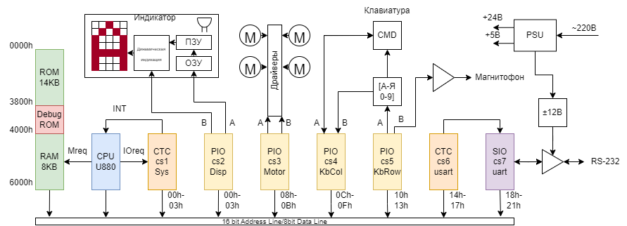
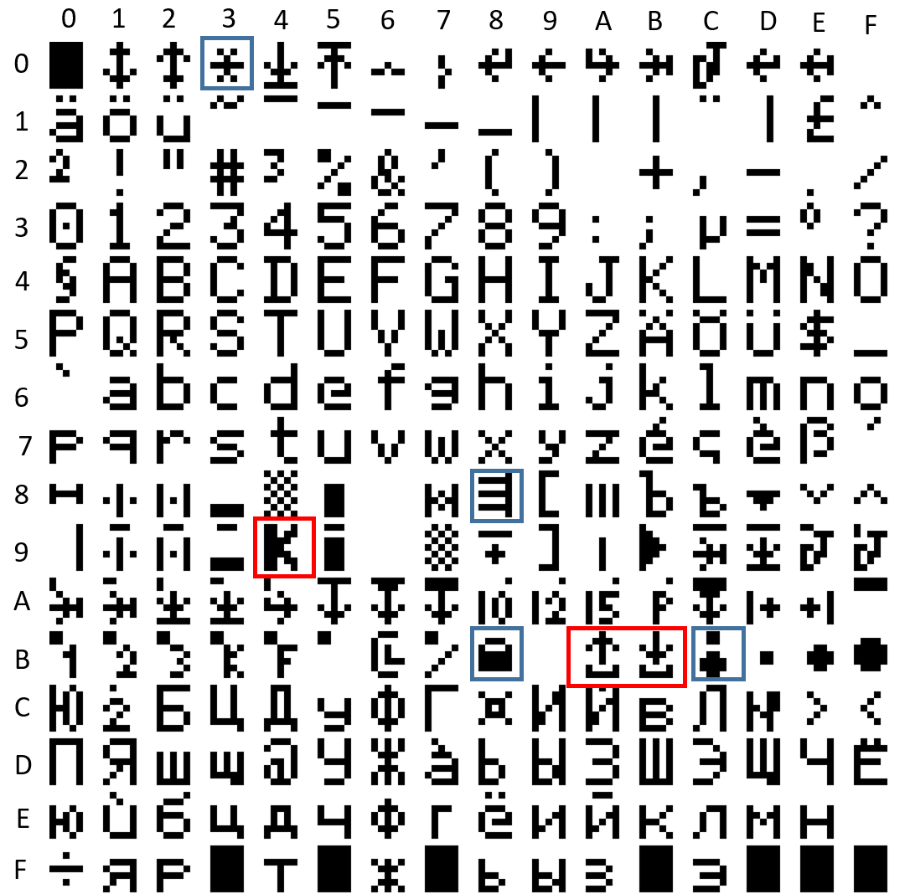

# Robotron S6130: аппаратная часть

Robotron S6130 — электронная пишущая машинка формата A2 серии S6100 (ГДР, 1986). Умеет хранить
тексты в ОЗУ с батарейным питанием, записывать их на магнитофон и обмениваться ими с ЭВМ по RS-232.

Источники: [статья на Хабре](https://habr.com/ru/companies/yadro/articles/886254/),
схема `doc/robotron_s6130-schema.pdf`, листинг `../fw/s6130.full.bin.asm`.



> **Опечатки на картинке:** у PIO cs2 (дисплей) порты `04h–07h`, а не `00h–03h`;
> у SIO cs7 порты `18h–1Bh`, а не `18h–21h`. В таблице ниже адреса верные.

## Процессор и тактирование

| Параметр | Значение |
|---|---|
| CPU | **U880**, нелицензионный клон Zilog Z80 (DIP-40, +5 В) |
| Кварц | 9,8304 МГц, делится на 4 → **2,4576 МГц** на CLK процессора и периферии |
| Прерывания | Режим **IM 2**, `I = 40h`. Таблица векторов в ОЗУ с адреса `4040h` |
| Стек | `SP = 4040h`, растёт вниз до `4000h` |
| NMI | `0066h → jp 5FFDh` — обработчик в самом конце ОЗУ (кто его туда кладёт, пока не выяснено) |

## Карта памяти

```
0000h ┌──────────────────────────┐
      │ ROM: 7 × 2 КБ (2716)     │  s6130.1.bin … s6130.7.bin
      │ 0000-07FF  ROM1          │
      │ 0800-0FFF  ROM2          │
      │   …                      │
      │ 3000-37FF  ROM7          │
3800h ├──────────────────────────┤
      │ Debug ROM (2 КБ)         │  восьмой корпус, на диагностическом устройстве
      │ 3800h: 'R' = признак     │  3803h: точка входа Debug_routine
4000h ├──────────────────────────┤
      │ RAM 8 КБ (16 × 4 Кбит)   │  батарейное питание (2 × Д-0,25), до 3 недель
      │ 4000-403F  стек          │
      │ 4040-405F  векторы IM2   │
      │ 4060-42FF  переменные    │
      │ ...        тексты        │
5FFFh └──────────────────────────┘
```

В новой плате вместо 7 ПЗУ стоит одна W27C512, вместо 16 ОЗУ — одна микросхема; сигналы ChipSelect
объединены. Признак целостности ОЗУ после выключения — слово `55AAh` по адресу `4222h`
(см. [прошивка](../fw/README.md#загрузка)).

## Периферия и порты ввода-вывода

Адрес порта 8-битный: `{A7,A6} = 00` — разрешение, `{A4,A3,A2}` — номер микросхемы (дешифратор 1 из 8,
восьмой выход не используется), `A1` — данные/управление, `A0` — канал A/B.

| Чип | Тип | Порты | Назначение |
|---|---|---|---|
| **cs1** | U857 (Z80-CTC) | `00h–03h` | Системный таймер. Ch0 — удар молотка, Ch1/Ch2 — шаговые двигатели, Ch3 — тик 1 мс |
| **cs2** | U855 (Z80-PIO) | `04h–07h` | Индикатор: 16 байт каждые 32 мс (12 символов 5×7 + светодиоды) |
| **cs3** | U855 (Z80-PIO) | `08h–0Bh` | Шаговые двигатели: A и B по два мотора на канал, фазы коммутируются программно |
| **cs4** | U855 (Z80-PIO) | `0Ch–0Fh` | Клавиатура: чтение столбцов (A — функциональные клавиши и датчики, B — алфавитно-цифровые) |
| **cs5** | U855 (Z80-PIO) | `10h–13h` | Клавиатура: выбор строк (A). Канал B — магнитофон, управление драйверами, DIP скорости |
| **cs6** | U857 (Z80-CTC) | `14h–17h` | Генератор скорости для SIO (прерывания в CPU не идут) |
| **cs7** | U856 (Z80-SIO) | `18h–1Bh` | RS-232 с DCD/DTR и CTS/RTS. На заводских платах не распаян |

Полный список имён портов (как в `tools/z80_trace.py`):

| Порт | Имя | Порт | Имя |
|---|---|---|---|
| 00h | Timer_Ch0 | 0Eh | Keyboard_Col_Ctrl_A |
| 01h | Timer_Ch1 | 0Fh | Keyboard_Col_Ctrl_B |
| 02h | Timer_Ch2 | 10h | Keyboard_Row_Data_A |
| 03h | Timer_Ch3 | 11h | Keyboard_Row_Data_B |
| 04h | Display_Data_A | 12h | Keyboard_Row_Ctrl_A |
| 05h | Display_Data_B | 13h | Keyboard_Row_Ctrl_B |
| 06h | Display_Ctrl_A | 14h | Timer_USART_Ch0 |
| 07h | Display_Ctrl_B | 15h | Timer_USART_Ch1 |
| 08h | Stepper_Data_A | 16h | Timer_USART_Ch2 |
| 09h | Stepper_Data_B | 17h | Timer_USART_Ch3 |
| 0Ah | Stepper_Ctrl_A | 18h | USART_Data_A |
| 0Bh | Stepper_Ctrl_B | 19h | USART_Data_B |
| 0Ch | Keyboard_Col_Data_A | 1Ah | USART_Ctrl_A |
| 0Dh | Keyboard_Col_Data_B | 1Bh | USART_Ctrl_B |

### Порт `11h` (Keyboard_Row_Data_B, PIO cs5 B) — служебные линии

Настраивается в режим 3 с маской `78h` (таблица в ПЗУ по адресу `024Fh`):

| Бит | Направление | Сигнал |
|---|---|---|
| 7 | выход | Запись на магнитофон |
| 6 | вход | Чтение с магнитофона |
| 5, 4 | вход | Не подключены |
| 3 | вход | VCC |
| 2 | выход | `~MIRED` (драйвер моторов) |
| 1 | выход | `~FBS` (лента / Farbband) |
| 0 | выход | `~DHM` (молоток / Druckhammer) |

## Прерывания

IM 2: CPU читает вектор с шины, складывает с `I = 40h` и берёт адрес обработчика из ОЗУ.
Адреса обработчиков таймера **подменяются на лету**: каждый мотор, пока работает, ставит в
ячейку вектора свою процедуру.

| Ячейка | Источник | Обработчик по умолчанию | Примечание |
|---|---|---|---|
| `4048h` | CTC cs1 Ch0 | `09D5h` INT_Timer_Ch0 | Молоток (DHM): `0A60h` INT_DHM_Set и др. |
| `404Ah` | CTC cs1 Ch1 | — | Протяжка бумаги / общий тик моторов: `0811h`, `0823h`, `0AA9h`, `0AB3h` |
| `404Ch` | CTC cs1 Ch2 | — | Каретка `08DCh`, литерный диск («ромашка») `093Ch` |
| `404Eh` | CTC cs1 Ch3 | `01FBh` INT_Timer_Ch3 | Системный тик ≈ 1 мс |
| `4058h` | SIO cs7 | `3480h` INT_USART_Hdlr | Приём символа |

Приоритет задаётся цепочкой IEI/IEO (`sch/rft_s6130.drawio`).

Системный тик: CTC Ch3, предделитель 256, константа 10 → 2,4576 МГц / 256 / 10 ≈ **960 Гц**.

## Клавиатура

89 клавиш в двух матрицах: алфавитно-цифровой и функциональной. PIO cs5 канал A выставляет строку,
PIO cs4 читает столбцы. На тех же линиях висят датчики (концевик крышки, датчики бумаги и
ленты) и DIP-переключатели настройки RS-232.

Одна клавиша кодируется байтом для `KeyboardReadColumn` (`rst 18h`):

```
A < 10h        : маска xxxx0000 на инвертированный Keyboard_Col_Data_A (датчики)
A[7:6] = 0x    : читать Keyboard_Col_Data_B   (алфавитно-цифровая матрица)
A[7:6] = 10    : читать Keyboard_Col_Data_A   (функциональная матрица)
A[7:6] = 11    : читать Keyboard_Row_Data_B   (служебные линии)
A[5:3]         : номер столбца (бит чтения)
A[2:0]         : номер строки (бит записи)
Результат      : Z = 1, если клавиша не нажата
```

Известные коды:

| Код | Клавиша / датчик |
|---|---|
| `82h` | Проверяется в `Setup_all` при старте |
| `99h` | **Концевик крышки.** С открытой крышкой машинка не стартует |
| `88h` | «Удар» (сила удара) |
| `89h` | «Шаг» (шаг письма) |
| `90h` | «Картридж» (лента) |
| `8Bh` | «Выравнивание справа» (Blocksatz) |
| `8Ch` | Приём по интерфейсу (RS-232) |
| `9Dh` | Передача по интерфейсу (RS-232) |
| `E8h`–`EFh` | DIP-переключатели RS-232 (бит 7 … бит 0) |

## Индикатор

Плата индикации с собственным знакогенератором (ПЗУ 2 КБ, `../fw/symbol_rom.bin`) и динамической
индикацией на VQC10 (`doc/vqc10.pdf`). Процессор каждые 32 мс отправляет через PIO cs2
16 байт из буфера `40ACh–40BBh` (инвертированные коды символов). Код `0Fh` — пустое знакоместо.



Таблица содержит латиницу, кириллицу, немецкие умляуты и служебные пиктограммы меню MOD:
`BCh` — сила удара, `03h` — шаг, `B8h` — картридж, `88h` — выравнивание, `BBh`/`BAh` — приём/передача,
`94h` — смена языка.

## Двигатели

Четыре шаговых двигателя: протяжка бумаги, каретка (Wagen), литерный диск, перемотка ленты.
Драйверы — четыре силовых ключа на мотор, без STEP/DIR: прошивка сама выдаёт последовательность
фаз в PIO cs3. Готовые байты фаз лежат в ПЗУ (например, `0091h–0098h`: `66 CC 99 33 66 CC 99 33`).
Также есть электромагниты молотка (DHM), ленты (FBS) и сигнал разрешения драйвера (MIRED).

## Магнитофон

PIO cs5 B: бит 7 — выход на запись, бит 6 — вход чтения. Кодирование и декодирование программные
(`Tape_*`, `TapeSomeMagic`, область `32F5h–33D2h`).

## RS-232

SIO cs7, канал A, тактируется от CTC cs6 Ch0 (`14h`, режим таймера, предделитель 16).
±12 В формируются на материнской плате делителем-удвоителем. Параметры линии задаются
DIP-переключателями, которые читаются через клавиатурную матрицу (коды `E8h`–`EFh`):

| Бит DIP | Код | Назначение | Регистр SIO |
|---|---|---|---|
| 7 | `E8h` | 1 — 8 бит данных, 0 — 7 бит | WR3 b7, WR5 b6 |
| 6–4 | `E9h`–`EBh` | Скорость (см. ниже) | WR4 b7–6 + константа CTC |
| 3–2 | `ECh`, `EDh` | Стоп-биты: `01` = 1, `10` = 1,5, `11` = 2, **`00` = синхронный режим** | WR4 b3–2 |
| 1 | `EEh` | Чётность: 1 — чётная | WR4 b1 |
| 0 | `EFh` | Контроль чётности включён | WR4 b0 |

Скорость = 2 457 600 / 16 / TC / делитель SIO:

| DIP[6:4] | TC CTC | Делитель SIO | Скорость, бод |
|---|---|---|---|
| `000` | 87 (57h) | ×16 | **110** |
| `001` | 64 (40h) | ×16 | 150 |
| `010` | 8 | ×64 | 300 |
| `011` | 8 | ×32 | 600 |
| `100` | 8 | ×16 | 1200 |
| `110` | 1 | ×64 | 2400 |
| `111` | 1 | ×32 | 4800 |
| `101` | 1 | ×16 | 9600 |

Таблица восстановлена по коду `UsartCtrl` (`33D3h`). Без распаянных DIP-переключателей все биты
читаются как 0: получается 110 бод, 7 бит, **синхронный режим** SIO. Отсюда патч `WR4 = 44h`
(см. [журнал оживления](../README.md#патчи-прошивки)). Если поставить DIP-переключатели, этот патч не нужен.

## Диагностический разъём

На разъём выведены шины процессора. Заводское диагностическое устройство (фото для S6010 —
в `doc/S6010_TI/`) подключает ПЗУ по адресу `3800h`. Если `(3800h) = 'R'`, прошивка сразу после
сброса переходит на `3803h` (см. [прошивка](../fw/README.md#загрузка)). Через этот же разъём
удобно подключать логический анализатор (переходник на IDC-40).
